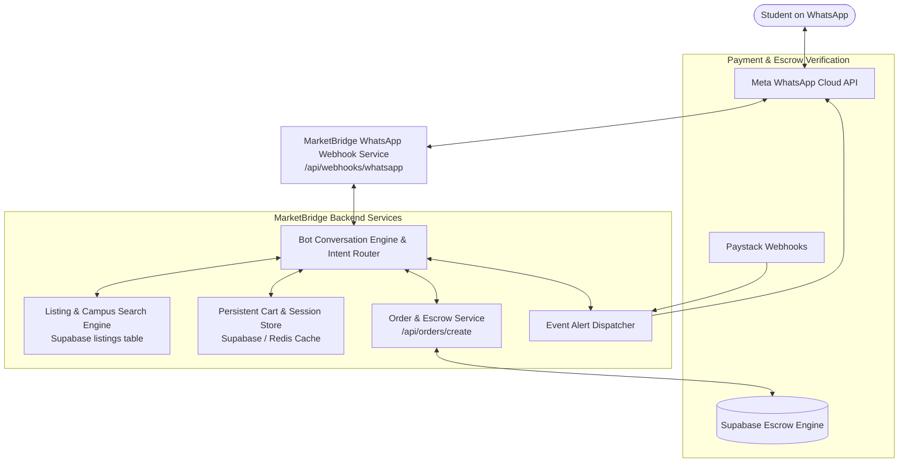

# MarketBridge WhatsApp Business Platform Integration Guide

## 1. Overview & Objective

This document outlines the architectural specifications for connecting MarketBridge's campus marketplace with the **WhatsApp Business Platform (Cloud API)**. 

The integration allows Nigerian university students to discover campus listings, build orders, receive escrow updates, and interact with buyers/sellers directly within WhatsApp without fragmenting the backend data layer.

All actions strictly leverage MarketBridge's existing:
1. **Supabase Database & Auth (Row Level Security)**
2. **Escrow State Machine (`orders`, `escrow_agreements`, `escrow_steps`)**
3. **Paystack / Moniepoint Server-Verified Payments**
4. **Campus Node Scoping (`universities`, `campuses`, `locations`)**

---

## 2. Integration Architecture Diagram



---

## 3. Core Functional Capabilities

### 3.1. Campus-Aware Product Search & Discovery
- **User Intent**: User texts *"Find economics textbooks in Unilag"* or *"Search iPhone 13"*.
- **Backend Flow**:
  1. Webhook extracts user message, phone number (`wa_id`), and intent.
  2. If the user hasn't selected a campus, bot prompts with interactive list message (`Unilag`, `Babcock`, `Baze`, `UniAbuja`, etc.).
  3. Queries `listings` table in Supabase:
     ```sql
     SELECT id, title, price, description, images, condition, seller_id
     FROM listings
     WHERE status = 'active'
       AND campus_id = :user_campus_id
       AND (title ILIKE :query OR description ILIKE :query)
     ORDER BY created_at DESC
     LIMIT 5;
     ```
  4. Formats results as WhatsApp Product Cards / Interactive List Message with title, price in Naira (₦), condition, and a *"View / Buy"* button.

### 3.2. Persistent Cart & Order Handoff
- **WhatsApp Native Cart vs Web Handoff**:
  - Uses WhatsApp Interactive Lists and Multi-Product Messages (MPM) linked to MarketBridge's Meta Commerce Catalog.
  - Cart state is persisted in Supabase keyed by `(buyer_phone_number, active = true)`.
- **Checkout Handoff**:
  - Rather than insecure text transfers, when the buyer clicks *"Proceed to Escrow Checkout"*, the bot generates a signed single-use checkout deep-link:
    `https://www.marketbridge.com.ng/checkout?session_id=<secure_signed_token>&source=whatsapp`
  - The buyer completes server-validated escrow payment (Paystack card/bank or Moniepoint manual transfer with proof).

### 3.3. Verified Payment & Escrow Notifications
- **Trigger**: Handled by existing [`app/api/webhooks/paystack/route.ts`](file:///c:/Users/excel/OneDrive/Documents/Marketbridge/app/api/webhooks/paystack/route.ts) upon receiving `charge.success` or admin manual transfer approval.
- **Actions**:
  1. Buyer receives WhatsApp confirmation:
     > *"Payment Confirmed! 🛡️ Your payment of ₦45,000 for 'Calculus Textbook' is locked safely in MarketBridge Escrow. The seller has been notified to arrange delivery on campus."*
  2. Seller receives instant WhatsApp alert:
     > *"New Escrow Order! 📦 Buyer 'Tobi' has secured payment in escrow for 'Calculus Textbook'. Meet at the Faculty Library to hand over the item. Do not release items without confirming recipient identity."*

### 3.4. Escrow Delivery Confirmation & Release
- **Security Rule**: Funds are **never released** purely from a WhatsApp text assertion.
- **Workflow**:
  1. Once delivery is scheduled, the bot sends an interactive message to the buyer:
     - Button 1: *"Confirm Item Received"*
     - Button 2: *"Report Issue / Dispute"*
  2. Clicking *"Confirm Item Received"* invokes `/api/escrow/advance-step` with the authenticated session, releasing funds to the seller's wallet.

---

## 4. API Endpoints Required for WhatsApp Bot

| Endpoint | Method | Description |
| :--- | :--- | :--- |
| `/api/webhooks/whatsapp` | `GET` | Webhook verification endpoint (handles Meta hub challenge verification) |
| `/api/webhooks/whatsapp` | `POST` | Ingestion endpoint for incoming messages, button clicks, and message status updates |
| `/api/whatsapp/catalog-sync` | `POST` | Cron job endpoint that syncs active Supabase listings with Meta Commerce Manager catalog |
| `/api/whatsapp/send-notification`| `POST` | Internal service endpoint used by Supabase database webhooks to fire order/escrow status alerts |

---

## 5. Security & Authentication Model

1. **Webhook Signature Verification**:
   All incoming requests to `/api/webhooks/whatsapp` must verify the `X-Hub-Signature-256` header using the app secret HMAC-SHA256:
   ```typescript
   const expectedSignature = crypto
     .createHmac('sha256', process.env.WHATSAPP_APP_SECRET!)
     .update(rawBody)
     .digest('hex');
   ```
2. **Phone Number Mapping**:
   Users on WhatsApp are identified by international MSISDN (`+234...`). The backend links incoming messages to `users.phone_number`. If unlinked, the bot initiates a 1-minute OTP verification linking their WhatsApp to their MarketBridge account.
3. **Escrow Guarantee**:
   All monetary settlements adhere to MarketBridge's server-enforced dispute arbitration.

---

## 6. Implementation Milestones

- [ ] **Milestone 1**: Register Meta WhatsApp Business App & Obtain Phone Number ID.
- [ ] **Milestone 2**: Configure Meta Commerce Manager catalog feed syncing from `listings`.
- [ ] **Milestone 3**: Implement `/api/webhooks/whatsapp` route handling challenge verification & incoming message router.
- [ ] **Milestone 4**: Connect Supabase database webhooks (`orders` on insert/update) to trigger WhatsApp template messages for order updates.
- [ ] **Milestone 5**: End-to-end sandbox testing on university pilot numbers.
